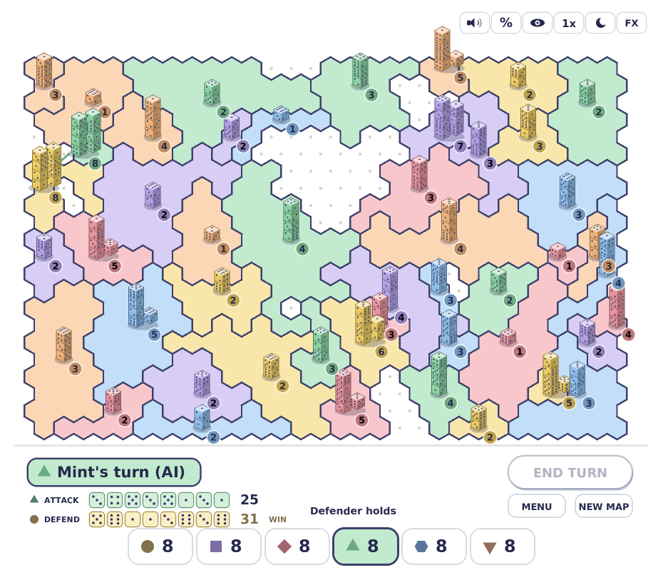
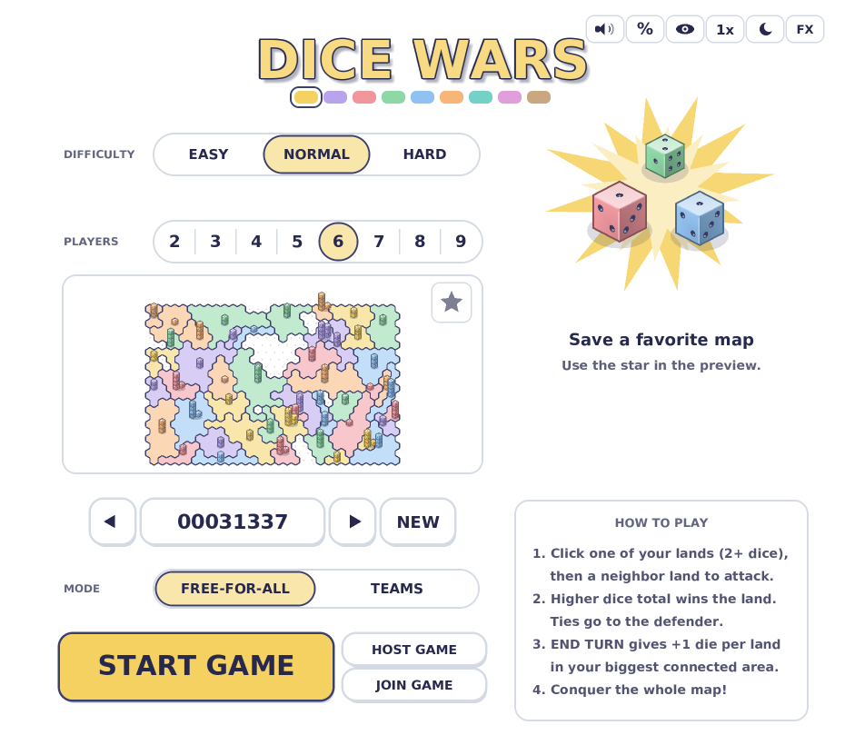
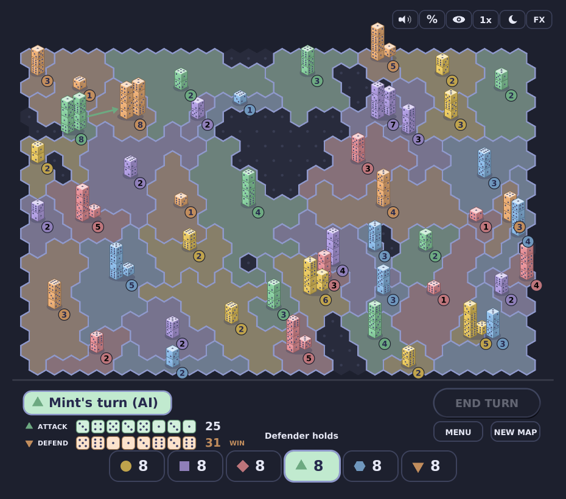
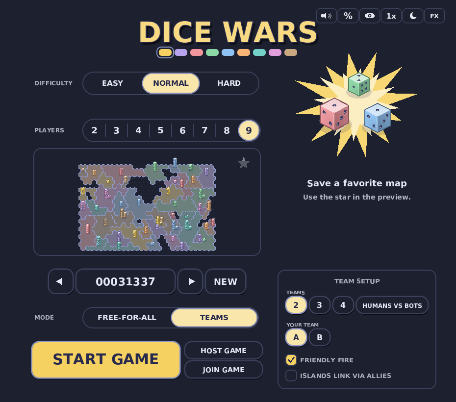

<div align="center">

# 🎲 Dice Wars

**A pastel Dice Wars–style territory conquest game in Rust.**

Hex maps · isometric dice · hidden AI personalities · seeded & bookmarkable maps · replays with GIF export · procedural sound

  









</div>

## Run / install

```sh
./run.sh              # build & play (or: cargo run --release)
scripts/build.sh      # build only — installs the Rust toolchain if missing
scripts/install.sh    # Linux: install to ~/.local/bin + desktop entry
scripts\install.bat   # Windows: install + Start Menu shortcut
scripts\build.bat     # Windows: build only
```

The game has **no Cargo dependencies**. Its native software renderer uses X11/XWayland and PulseAudio on Linux, and Win32/GDI plus Windows audio on Windows. A GPU context is not needed. On Debian/Ubuntu/Mint, the runtime libraries are `libx11-6` and `libpulse0` (normally installed with the desktop).

Build scripts install the Rust toolchain if missing and default to **one build worker** to keep the desktop responsive. Settings, bookmarks, and exported replay GIFs live in your platform's user-data directory (`~/.local/share/dice-wars` on Linux, `%APPDATA%\dice-wars` on Windows).

## Start screen

- **Your color** — click a swatch in the band under the title to pick the color you play as; your current pick is highlighted.
- **Players / Humans** — choose 2–9 total players. Pick any color for yourself with the swatch band; every player has a unique color and symbol. For multiplayer, host a lobby — joined players get the first seats and AI fills the rest.
- **Difficulty** — EASY bots hesitate, need a big advantage, and pick sloppy targets; NORMAL plays by personality; HARD bots gamble on even odds, consolidate territory, and prefer attacks with friendly backup. Every difficulty uses the same dice rolls, random reinforcement placement, and reserve limits as humans. Bots assess opponents by board strength, without a bonus for targeting humans.
- **Mode** — FREE-FOR-ALL is the classic last-player-standing game. TEAMS ends the game when only one team is left alive: pick 2–4 teams and which one you play on (bots spread evenly across the rest), or choose HUMANS VS BOTS to put every human on one side. Everyone still plays for themselves — no shared dice or reinforcements. Two extra rules are toggleable: **Friendly fire** (teammates may attack each other, on by default) and **Islands link via allies** (your separated islands count as one connected region when teammate land bridges them, which boosts END TURN reinforcements — off by default). Bots never attack their own team. Everything persists in `settings.txt` and applies to hosted online games too.
- **Map preview** — the generated map is shown live. Deals are fairness-balanced: every player starts with a comparable largest cluster, equal territory counts, and the first player is decided by the seed.
- **Seed** — maps are deterministic: the same 8-digit seed and player count always produce the same map. Click the seed to type one in, use `<` / `>` to step through neighboring seeds, or `NEW` (or `N`) to skip to a random map.
- **Bookmark map** — the fixed-size, five-point star saves the current seed + player count to `bookmarks.txt`; click a bookmark to load it, or its `x` to delete it.
- **Toolbar** — sound, win chances, color assist, 1x/2x speed, light/dark theme, and reduced motion. Hover for the current state and keyboard shortcut. Settings persist in `settings.txt`.
- **Hover feedback** — buttons, toolbar icons, selected options, color swatches, checkboxes, and bookmark deletion visibly react on hover in both themes. Neutral controls gain an accent tint; colored controls preserve label contrast.
- **Themes** — the surrounding surfaces, labels, controls, dialogs, and outer background switch on the input frame. Territory pastels, map outlines, and dice retain their original colors in dark mode; colored buttons keep readable labels in both themes.
- **Accessibility** — protan color assist uses separated hues and owner-symbol badges. Dice pips and colored control labels choose contrasting ink. Reduced motion removes shaking, bouncing, floating text movement, and selection pulsing. [Nine-player accessibility screenshot](assets/screenshot-accessible.png).
- **START GAME** (or `ENTER`) plays the previewed map.

## Online play

**HOST GAME** opens a lobby on TCP port 7777 with a random 6-digit room code and shows your LAN address (with a copy button). Guests join with **JOIN GAME** (address + code); the host presses START whenever ready — connected players get the first seats (host is P1) and AI fills every remaining slot. Works on a LAN or VPN out of the box; across the internet the host needs port 7777 forwarded.

The same toolbar is available in the start screen, game, lobbies, join screen, and replay. Local appearance preferences do not change the host's game rules.

The host is authoritative: guests send intents, the host validates them, rolls the dice, and broadcasts results. Basic hardening is built in — five wrong codes temporarily block that address, connections are rate-limited and capped, and messages are strictly length-limited.

Network traffic is not encrypted, so use a trusted LAN or a private VPN such as Tailscale. Directly forwarding port 7777 exposes room codes and reconnect tokens to anyone able to observe that connection.

**Can't connect on the same network?** The host's firewall is usually the culprit — on Ubuntu/Mint run `sudo ufw allow 7777/tcp` once. Guest-WiFi networks with "client isolation" also block device-to-device connections. For playing across the internet, either forward TCP 7777 on the host's router or use a VPN like Tailscale (easiest).

## How to play

- **Click one of your territories** (it needs more than 1 die), then **click an adjacent enemy territory** to attack. Selecting a territory shows arrows to every legal target with its exact win probability.
- Both sides roll all their dice in **two compact rows in the existing status area**. Attack/defend labels, player symbols, totals, and an explicit result explain the battle. The map, player cards, and action buttons stay visible. Higher total captures the territory (the stack moves in, leaving 1 die); ties and losses reduce the attacker to 1 die.
- **Keyboard play** — arrow keys focus territories, `ENTER` selects or attacks, and `SPACE` ends the turn. Focused land gets an outlined border. `ESC` cancels the selection or opens the menu confirmation.
- **END TURN** (or `SPACE`) ends your turn: you receive one die per territory in your largest connected region, distributed randomly. Dice that don't fit (all territories full) are stored off-board — up to 64, like the original — and return on later turns. The button shows your total incoming dice.
- `R` opens the new-map confirmation. `M` toggles sound outside text fields, `F10` switches light/dark mode, `F9` toggles color assist, and `F8` toggles reduced motion. `ENTER` or `ESC` dismisses a destructive-action confirmation and keeps playing.

All sound effects are synthesized procedurally at startup (no audio asset files). Linux output automatically re-buffers after silence so short clicks and later battle effects are audible. Audio device failures are reported to stderr.

Each AI has a hidden personality, rolled from the map seed — some attack recklessly, some wait for a clear advantage, some scheme against whoever is winning. All bots share a survival instinct: when one player grows dominant, they stop wearing each other down and gang up on the leader.

Win by conquering the whole map — or, in team mode, by being on the last team standing. Player cards show each player's symbol and land count (plus a small +N when they have dice stored off-board). In team mode, cards are grouped inside shared `TEAM A` / `TEAM B` outlines, and protected allied lands stay colored but dimmed while you choose an attack target.

## Replays

The game-over screen offers **WATCH REPLAY** — an animated playback of every battle and reinforcement of the finished game — and **SAVE GIF**, which fast-forwards through the replay and writes a timelapse `replay-<seed>.gif` (up to 600 frames sampled across the entire match, including the ending; self-contained GIF encoder, no external tools).

The UI font is DejaVu Sans Bold, embedded as coverage masks (Bitstream Vera license). The source font and a development-only asset packer are included.

## Responsiveness and resource use

- Input is polled at up to 60 Hz. Animated frames are capped at 60 fps; unfocused windows use 15 Hz.
- Unchanged menus and idle single-player human turns reuse the previous frame. Boards, previews, status panels, and dice illustrations use bounded caches; moving effects render separately. Moving the cursor inside the same territory keeps the map cache.
- Normal windows use 2× rendering in each dimension for smooth dice, hex borders, and text. Raster work is capped at four million pixels; the filtered output retains the window resolution, including 2560 × 1600 and 4K. Larger windows use fewer subpixels within that budget. Offscreen exports have explicit size limits.
- Only changed tiles are filtered again. Linux uploads the changed rectangles and skips identical frames, avoiding full-window copies for a small dice animation. Exposed windows receive a complete repaint.
- Dice illustrations have a 16 MiB cache limit. The previous raster used for change detection stays within the four-million-pixel budget.
- Audio uses one worker, at most 16 simultaneous voices, and a bounded request queue. Missing audio devices leave the game silent.
- Maps retain the seeded PCG stream used before the engine migration, preserving existing seeds and bookmarks.

## Development checks

```sh
cargo test --release -j 1 -- --test-threads=1
cargo check --target x86_64-pc-windows-gnu --all-targets -j 1  # optional cross-platform check
python3 scripts/audit-ui.py                               # requires Pillow
python3 scripts/audit-runtime.py                          # Linux: bounded, isolated frame-time checks
python3 scripts/audit-runtime.py --native                 # opens two short test windows
python3 scripts/audit-audio.py                            # Linux: requires pactl + parec
python3 scripts/pack-assets.py                            # only after changing font/icon sources
```

Version 1.4.2 passed 42 automated tests and 29 screenshot scenarios on Linux. The Windows backend passed cross-compilation checks; Windows runtime testing is still outstanding.

The UI audit uses temporary settings, bounded headless runs, and reproducible seeds. It captures light/dark menus and battles, team setup, accessibility, dialogs, join/replay screens, and small/wide/high-resolution layouts; it verifies native screenshot dimensions, mouse and keyboard theme changes on the input frame, unchanged pastel map art when switching themes, visible button hover fills in both themes, bookmark states and uniform star fills, and upright GIFs. Each scene uses separate temporary preferences.

The runtime audit reports frame work separately from the 60/15 Hz cap and measures CPU time. Its results depend on background load and power settings; the cap does not guarantee 60 fps on every device. The audio audit routes only its test game's output into a temporary sink and verifies two short effects separated by silence, then removes the sink. It does not record a microphone or change the default audio output. This regression check fails against 1.4.0 and passes against 1.4.1.

In the Linux native battle check (120 frames with background CPU load), 1.4.1 used **2.31 seconds of CPU time**, compared with **6.65 seconds** for 1.4.0. Wall time fell from 6.85 to 2.82 seconds. These are measurements from one device, rather than a guaranteed frame rate.

For a bounded desktop smoke test:

```sh
DW_FRAME_LIMIT=120 DW_CAPTURE=/tmp/dice-wars.png ./target/release/dicegame
```

The game closes automatically after the specified frame count. `DW_HEADLESS=1` captures using the same renderer without opening a window; `DW_SIZE=1200x820` selects a headless viewport.
