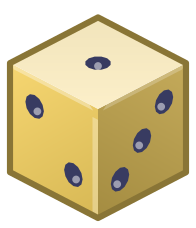
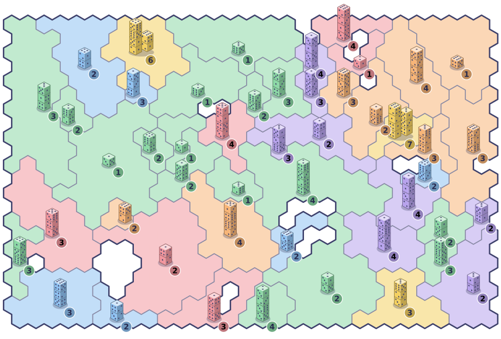

  

<h1 align="center">Dice Wars</h1>

  A pastel territory-conquest dice game in dependency-free Rust. 
  <strong><a href="docs/GUIDE.md">Read the player guide »</a></strong>

  
  
  

Conquer a hex map by rolling stacks of dice against your neighbours. Play
against up to eight bots with hidden personalities, or with friends on your
local network. Maps come from an 8-digit seed, so any good map can be
bookmarked and replayed, and every finished game can be watched again or
saved as a GIF.

## Install and run

Download Dice Wars from GitHub (Code, then Download ZIP), unzip it, and run
the installer for your system from inside the folder. Each installer first
gets what it needs to build the game, so nothing has to be installed
beforehand.

| System | Run |
| --- | --- |
| Linux | `bash install-linux.sh` — [installer](install-linux.sh); gets the C build tools and audio/X11 libraries (asks for your sudo password) and Rust. |
| macOS, Apple silicon / Intel | `bash install-macos.sh` — [installer](install-macos.sh); gets Apple's command line tools (click Install in Apple's window) and Rust. |
| Windows | double-click `install-windows.cmd` — [installer](install-windows.cmd); gets Rust with its own linker, no Visual Studio needed. |

Each installer prints what it is doing and ends with SUCCESS or FAILED. Then
start **Dice Wars** from your app menu, Launchpad or Start Menu, or run
`dice-wars` in a terminal. Options and uninstalling are covered in the
[install guide](docs/INSTALL.md).

Prefer not to build? Every [release](https://github.com/LenniAConrad/dice-wars/releases)
has ready-to-run downloads for Linux (x86_64), Windows (x64) and macOS
(universal). The Mac app is not notarized: if macOS refuses to open it, go to
System Settings → Privacy & Security and click **Open Anyway**.

  

## How to play

Click one of your lands with two or more dice, then a neighbouring enemy land
to attack. Both sides roll all their dice; the higher total wins, and ties go
to the defender. **END TURN** gives you one new die for every land in your
largest connected region. Conquer the whole map to win.

| Key | Action |
| --- | --- |
| Arrow keys, `Enter` | focus a land, select it or attack |
| `Space` | end your turn |
| `Esc` | cancel the selection, or pause |
| `R` | new map |
| `M` | sound: full, half, off |
| `F8` / `F9` / `F10` | less motion / colour assist / next theme |

Everything else — seven themes, game speed, win chances and accessibility
options — is in **Settings** at the top right of every screen. Hold `Space`
during bot turns to fast-forward.

## Playing together

Press **HOST GAME** and your lobby appears in every **JOIN GAME** screen on
the same network, ready to join with one click, the way LAN worlds work in
many games. Hosts can also share their address and 6-digit room code for VPN
play. Details and firewall tips are in the [player guide](docs/GUIDE.md#playing-together).

## Guides

- [Player guide](docs/GUIDE.md): rules, teams, difficulty, multiplayer, replays and accessibility.
- [Install guide](docs/INSTALL.md): installer options, manual builds and uninstalling.
- [Development](docs/DEVELOPMENT.md): [project layout](docs/DEVELOPMENT.md#project-layout), headless checks, test hooks and performance.

## License

MIT, see [LICENSE](LICENSE). The interface font is Nunito (SIL Open Font
License); see [assets/FONT-LICENSE.txt](assets/FONT-LICENSE.txt).
